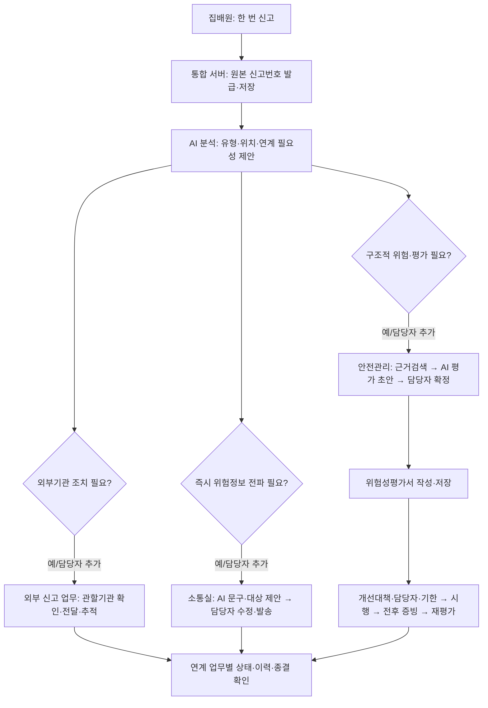
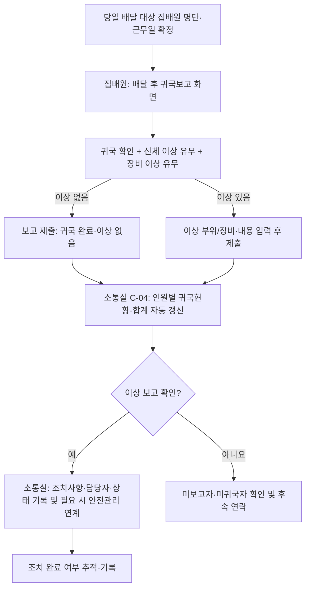
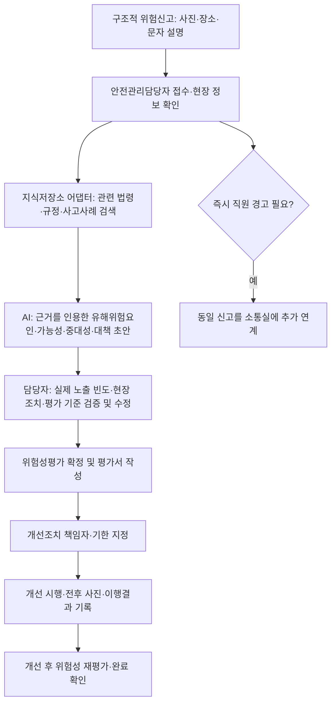
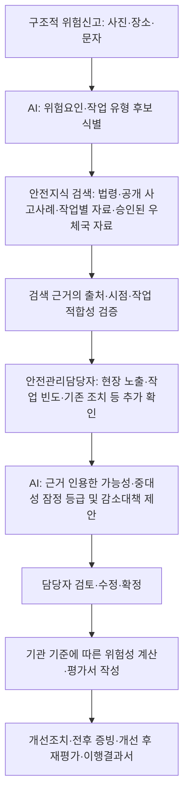

# AGENTS.md — 안심ON 통합 신고·안전관제·위험성평가 개발 지침

> 상태: **목표 설계 및 개발 지침**. 본 문서는 기존 코드의 구현 완료를 뜻하지 않는다. 개발 에이전트는 먼저 실제 저장소를 조사하고 구현됨/부분 구현/미구현을 표시한 후 작업한다.
>
> **작업 전 필수**: 모든 작업을 시작하기 전에 `docs/working-rules.md`(결과 재검토·근거 검색 방식·시뮬레이션 규칙·진행 방식)를 먼저 읽고 따른다. 남은 일은 `docs/todo.md`에서 하나씩 해결하고, 단계가 끝나면 `docs/dev-history.md`(개발 과정 압축 기록)에 한두 줄 덧붙인다.
>
> 목적: 공모전 출품 → 장흥우체국 소규모 시범운영 → 승인·보안 검토를 거친 실제 우체국 도입. 기존 기능을 보존하며 단계적으로 확장한다.
>
> 지향점(사용자): 위험성평가 홈페이지를 **우체국 산업안전 업무 전체를 모으는 통합 홈페이지**로 키운다. 종이·엑셀·담당자별로 흩어진 관리 방식을 없애고 계획·기록·증빙·보고를 한곳에서 한다(4-1절).

## 현재 코드 기준 (2026-09-27)

이 절은 목표 설계와 구분한 실제 구현 현황이다. 변경 시 `server.js`, `public/safety.html`, `public/report.html`, 테스트를 다시 확인해 갱신한다.

| 기능 | 현재 상태 | 실제 코드·제약 |
|---|---|---|
| 소통실 상황관제 | 구현됨 | `public/safety.html`, `/api/safety/state`; 음성 위험신고, 통화, 안전 알림, 귀국현황을 표시한다. |
| 공지사항 | 구현됨 | `/api/on/notices` 및 확인 API. 단일 공지이며 수신 대상·발송자·확인 시각을 보존한다. |
| 안전 알림·확인 | 구현됨 | `/api/safety/alerts`, `/:id/ack`. 구역/전체 대상과 수신자별 앱 확인 시각을 보존한다. 실제 단말기 전달 성공을 보증하는 수치는 아니다. |
| 반복 발송 중단·미확인자 조치 | 구현됨 | 안전 알림과 공지는 기록을 지우지 않고 반복 발송을 중단할 수 있다. 안전 알림의 수신 대상자별 후속 조치 이력을 저장한다. |
| 관제실 통화 | 부분 구현 | 전화 버튼은 발신 시도만 기록하며 통화 연결 완료로 표시하지 않는다. 소통실은 수신 통화를 명부 기준으로 기록하고 통화 메모(수정 이력 보존)를 작성한 뒤 메모와 연결된 집배구별/전체 알림을 보낸다. **통화 녹음·문자 변환은 제거되었다.** 과거 기록의 녹음 파일은 디스크에 남기되 화면·API로 노출하지 않는다. 전화선·교환기 자동 녹음 연동은 없다. |
| 귀국보고·이상 조치 | 구현됨 | `/api/on/return`, `/api/on/returns`, 조치 API. 신체·장비 이상, 결원, 미보고, 관제 확인, 조치 담당자·상태·시각을 기록한다. 월별 집계는 사람 고유 수가 아닌 일별 인원 합계다. |
| 통계·증빙 | 구현됨 | `/api/safety/evidence`로 일별·월별 공지/위험 알림, 통화, 귀국보고 이상·조치를 조회한다. 별도 일별/월별 가상 샘플은 브라우저에서만 계산하며 실제 기록에 저장하지 않는다. 현원은 총원에서 결원을 뺀 인원이고 미보고자는 이상 없음에 포함하지 않는다. |
| 계정·로그인 | 부분 구현(교체 예정) | `server.js` 고정 계정(비밀번호는 Railway 변수 `PW_*`), 메모리 세션(재배포 때 전원 로그아웃), 로그인 시도 제한은 데모용으로 꺼 둠. 시험 계정 `daedeok1`(장흥대덕 담당자)·`daedeok2`(장흥대덕 국장)·`daedeok3`(장흥대덕 직원, 앱 신고용, 소통실 명부에는 없음)와 총괄국 역할 시험용 `jhpost`(우편팀장)·`jhcomm`(소통팀장)·`jhsales`(영업과장)·`jhlogi`(우편물류과장)·`jhchief`(총괄국장)는 지어낸 사람 이름(「김민수(시험)」 등, 2026-11-07)을 쓰며 `PW_TEST_OFFICE` 하나로 로그인한다(`jip5`=서무팀장·총괄 안전담당자, 2026-11-04~07, 명단 계정 때 삭제). 직원 명단 확보 후 1-1절 방식(명단 대조 가입·내근/외근 구분·관리자 화면)으로 교체한다. |
| 데이터 저장 | 시범 구현 | `safety.json` 등 JSON 파일과 사진을 `DATA_DIR`(Railway Volume을 붙이면 그 경로, 없으면 앱 폴더 — 재배포 때 지워짐)에 저장한다. `/api/health`의 `storage.persistent`로 확인한다. 실제 운영 전 DB, 동시성, 백업, 접근 통제, 보존 기간 검토가 필요하다. 서버의 시연 데이터 자동 생성은 기본 꺼짐이며 `SAFETY_DEMO=on`일 때만 동작한다. 통계·증빙의 4일 예시는 브라우저에서만 합쳐 표시하고 실제 기록에 저장하지 않는다. |
| 위험성평가·외부 연계 | 부분 구현 | `public/risk.html`과 Supabase 안전지식 어댑터가 있다. 안전보건담당자의 직접 발굴 항목 접수, 시작·종료일 및 일별/3개월/6개월/1년 단위 조회·집계·엑셀 출력, 공정 선택 출력과 평가표 직접 편집을 지원한다. 국가법령정보센터 현행 법령·고시·행정규칙 108종을 조문 단위로 적재·검색할 수 있다(2026-11-04 기준 108종 모두 Supabase에 적재·확인, 별표 자료 3건과 KOSHA GUIDE 81건 포함 목록은 `supabase/loaded-sources.json`). 목록은 각 상위법의 법령체계도(행정규칙 포함)에서 우체국 시설·작업에 해당하는 것을 골랐다. 산업안전(산안법·시행령·시행규칙, 안전보건규칙, 위험성평가 지침, 근골격계부담작업·방호조치·안전검사·보호구·안전인증 고시), 소방(소방시설법·화재예방법 및 각 시행령·시행규칙, 화재안전성능기준 NFPC 101·102·103·203·303·304), 전기(전기안전관리법·시행령·시행규칙, 전기설비기술기준), 건축(건축법·건축물관리법·시설물안전법 및 각 시행령·시행규칙, 피난·방화구조 기준 규칙), 승강기(승강기 안전관리법·시행령·시행규칙). 행정규칙에는 감전재해 예방·운반하역·추락재해방지 등 산업안전 기술지침, 위험기계·방호장치·보호구 안전인증·자율안전확인 고시, 화재안전기술기준(NFTC 101·102·103·201·203·205·301·303·304·609)과 해당 성능기준, 소방시설 자체점검 고시, 전기설비 검사·점검 고시, 건축물관리점검지침, 시설물 안전 및 유지관리 지침, 승강기 안전운행 운영규정 등이 있다. NFTC처럼 조 대신 2.1·2.1.1 번호를 쓰는 기준은 두 번째 단계 번호로 나눠 저장하고 그 번호로 인용한다. 별표는 이미지로만 제공되어 기본 적재에는 없고, 산안법 시행규칙 별표 6·7·8(안전보건표지 종류·용도·설치장소·색도)만 이미지를 글로 옮긴 별도 자료(`별표 N …` 위치, 「… 별표 7」로 인용)로 만들었다. 소방시설법 시행령 별표 1·2(우체국 관련 발췌)·4·5(소방시설 종류, 특정소방대상물—우체국은 업무시설, 설치기준, 면제기준)도 같은 방식으로 옮겼다. 액화석유가스법 시행규칙 별표 20(사용시설의 시설·기술·검사기준)은 원문 PDF가 글이라 그대로 추출해 용기·소형저장탱크 사용시설 부분만 넣었다(2026-11-04). Supabase에 올린 자료의 버전은 `supabase/loaded-sources.json`에 기록하고, 매월 1일 0시(KST) 예약 작업이 현행 버전과 비교해 바뀐 자료만 SQL로 만든다. 한국산업안전보건공단 KOSHA GUIDE(기술지원규정) 중 우체국 시설·작업 관련 81건(넘어짐·통로, 적재·하역·인력운반, 컨베이어·운반차량, 전기설비·누전·접지, 비상조치·비상조명, 조명·환기·사무환경, 보호구, 한랭·온열, 고소작업 등)을 `scripts/prepare-kosha-guides.cjs`로 원문 PDF에서 글로 추출해 `4.2 제목` 단위 SQL로 만들었다(kind `guideline`, 법령이 아니므로 법령 근거로 인용하지 않음). 그림으로만 된 PDF 5건 중 이동식 사다리(A-G-4)와 통로·계단·경사로·안전난간(A-G-2)은 화면을 보고 글로 옮겨 넣었고(`transcribed_from_image`), 창고 작업·지게차·오토바이 배달도 같은 방식으로 옮겨 넣었다(2026-11-01). 고정식 사다리(B-M-1)와 급식실 3건(A-G-5·6·10)은 2026-11-04 다시 받아 보니 글 PDF로 바뀌어 그대로 추출했다(자동 OCR은 수치 오류 위험으로 쓰지 않는다). SQL Editor 없이 `scripts/load-knowledge-rows.cjs`로 서버 키(REST) 적재도 한다. 웹 원문 SQL이나 앱의 「공식 법령 최신본 적재」 버튼(Open API)으로 다시 적재하면 같은 자료의 옛 버전 조문은 지우되 위험성평가 근거로 연결된 조문은 남긴다. 두 경로 모두 조문 위치를 `제N조(제목)`(기술기준은 `2.1 제목`)으로 저장하고 장 제목·삭제 조문은 넣지 않아, 어느 경로로 적재해도 같은 행을 갱신한다. 한 자료가 실패해도 나머지는 적재하고 실패 자료명·사유를 표시한다. 중대재해처벌법은 개별 위험의 개선대책 근거로 맞지 않아 넣지 않았다. Open API(`LAW_API_OC`)가 없을 때는 `scripts/prepare-official-laws-from-web.cjs`로 공개 페이지에서 같은 형식의 SQL을 만들어 Supabase SQL Editor에서 실행한다. 국가법령정보센터 원문인 고시·지침·기준도 관련 법령 칸과 승인 법령 검색에 포함한다(출처가 law.go.kr인 경우만). 외부기관 자동 전송과 승인되지 않은 내부자료 연계는 완료 기능으로 표시하지 않는다. |

건강·장비관리대장은 귀국보고일 범위로 조회하며 직원별로 각각 출력한다. 귀국 이상 조치에는 기한을 입력하지 않고 조치 상태·내용·변경 이력과 완료 시각·결과를 보존한다.

위험성평가는 사용자 제공 `riskchecklist3step_guide.pdf` 5페이지의 3단계 기준(상·중 허용 불가능, 하 허용 가능)을 사용한다. 평가표는 7페이지 열 구성, 이행결과서는 `이행결과서.jpg` 양식에 맞춘다. 기존 5×5 점수는 보존하되 자동 환산하지 않고 재검토한다. 이 변경은 귀국보고 건강·장비대장과 별개이며 위험성평가의 개선 예정일·완료일은 유지한다.

## 숙제 목록 (미해결 과제) — 사용자가 "남은 일·못 한 일"을 물으면 이 목록으로 답한다

사용자 결정(2026-11-04): 아래는 지금 하지 않고 **나중에 해결할 숙제**로 남긴다. 사용자가 물으면 무엇이 아직 해결되지 않았는지, 무엇 때문에 멈춰 있는지를 이 목록으로 알려 준다. 해결하면 이 목록에서 지우고 `docs/dev-history.md`에 한 줄 남긴다. 세부 항목은 `docs/todo.md`.

| 숙제 | 지금 상태 | 막힌 이유·필요한 것 |
|---|---|---|
| 산업안전 통합 관리 홈페이지: 1년 다이어리(S-06), MSDS·유해물질 구입 시 등록(S-07), 그 밖의 연간 업무 | 미착수(설계만 4-1절) | 연간 업무 목록·주기 확정(사용자). MSDS 고시 2종은 2026-11-04 적재(노출기준 고시의 물질별 수치 별표는 표가 커서 미적재, MSDS 기능 만들 때 필요하면 추가) |
| 계정·회원가입·관내국 운영(1-1절) | 설계 확정, 미구현 | 직원 명단(이름·휴대폰·소속국·내근/외근·외근 집배구)과 특별 계정 지정(사용자) |
| 관내국 위험성평가 결재·총괄 수합·전남청 보고 출력 | 역할(총괄 안전담당자·공정 담당자·결재자·총괄국장)·배분·건별 결재선(총괄국 과장→서무팀장→우편물류과장→총괄국장, 관내국 국장)·선택 결재·설정 탭·결재란 4칸 구현(2026-11-07 2차, 시험 계정). 청 보고는 기간 출력·엑셀을 공식 결재에 붙임 | 남은 것: 직원 명단(직함 포함)으로 실제 직원 지정(사용자), 나머지 관내국 계정(명단), 전남청 보고 양식(사용자), 1-1절 "미정" |
| Supabase 무료 플랜 일시 정지 대비 | 깨우기 신호·백업 구현(2026-11-04), 운영 반영은 병합 후 | 7일간 사용이 없으면 프로젝트가 멈춤(멈춘 뒤 약 90일 안에 복구, 무료는 자동 백업 없음). 서버가 하루 한 번 1행을 읽고(Railway 서버가 켜져 있어야 함), 근거자료실 「근거 자료 백업 내려받기」로 전체를 받는다. 남은 것: 자료를 바꿀 때마다 백업 받아 기관 승인 장소에 보관(사용자), 명단·계정을 올려 실제 운영할 때 Pro 플랜 전환 검토, 일시 정지 예고 메일 확인 |
| 데이터 보존: Railway Volume, 운영 데이터 매일 백업, 로그인 시도 제한·세션 저장 | 코드 준비(`DATA_DIR`, `/api/health`), 연결 보류 | 사용자가 필요할 때 Volume 연결. 그전엔 main 병합 때마다 운영 시험 데이터·사진이 지워진다 |
| 근거 자료 보완 | 대부분 해결(2026-11-04) | 남은 것: 리튬 배터리 충전 전용 지침은 KOSHA에 없어 E-185(리튬이온 ESS)·E-10(축전지)으로 대신함(소방청 자료는 이 환경에서 접속 차단), 세제·소독제 등 제품별 위험은 MSDS 등록 기능(S-07)으로 다룸 |
| AI 초안 개선 | 일단락 후 남은 것 | 운영에서 위험 우선 초안 확인, 「우체국 유해위험요인 점검항목(서식)」 408항목(2026-11-07 장흥 2026 평가표 사진에서 빠졌던 7항목 추가)의 항목별 개선대책(2026-11-04 AI 작성·조문 대조, 11-05 법적 의무를 대책에 반영·유사 사고사례 확인, Supabase 반영)을 담당자가 검토본 엑셀로 확인·수정(사용자), 점검항목 표현 시험지로 효과 측정, 순위 단어 검색 함수 2.5~3초 단축(009 SQL), 대책-근거 연관성 개선, 근거·대책 체크 선택 화면, 월 사용량 표시, 초안 효과 기록(작성 시간·채택률), 단어 빈도 DB 계산(009 SQL) |
| 운영 확인 | 미완료 | Cohere 키 동작(「근거 순위」 줄 캡처), 운영 소요 시간, 설치 안내 실기기 따라 하기, APK 실기기 설치, 사용자가 지정한 위험성평가 샘플 1건 삭제(식별번호 필요) |
| 정식 도입 준비 | 미착수 | AI 주소·모델 설정화(내부망 엔진 교체 대비), GitHub 저장소 비공개 전환(사용자), 행정포털·망 연계 확장 로드맵 문서 |
| 시범운영 종료 절차(몇 달 시험 후 중단할 수 있음, 2026-11-04) | 미정 | 종료 전 근거 자료·운영 기록 백업과 성과 측정값 정리 → 직원 명단 등 개인정보 삭제 → Supabase·Railway·OpenAI·Cohere 정리. 코드·문서는 GitHub에 남김. 시험 기간에는 Supabase 무료 플랜 유지 |

### 2026-10-13 로컬 변경 (운영 반영 미확인)

- 구현됨: AI JSON 응답 잘림·형식 오류는 한 번만 복구를 시도한다. 인증·설정 실패는 자동 재요청하지 않으며 작성/재검토 단계의 오류로 구분한다.
- 구현됨: 기본 외부 검색 모델 `gpt-4.1-mini`에는 미지원 `filters`를 보내지 않는다. 검색 도구가 반환한 URL 및 서버의 공식기관 도메인 검증은 유지한다. 검색 응답 형식 오류를 검색 결과 없음으로 숨기지 않는다.
- 구현됨: 근거 확보 순서는 ① 승인된 내부 자료(Supabase 법령·SIF 사례) → ② 쓸 만한 내부 근거가 3건 미만일 때(또는 담당자가 재검색을 고를 때)만 AI 외부 공식기관 자료 검색(2026-11-02 변경: 법령 인용은 선택 사항이라 "승인된 법령 없음"은 더 이상 외부 검색 조건이 아니다. 점검표가 정확히 맞는 사례에서 약 6초만 늘고 얻는 것이 없었다) → ③ 둘 다 없거나 실패하면 근거 없는 초안을 `review_required`(근거 미확인)로 표시한다. 이 초안은 자동 저장하지 않으며 인용 근거를 만들지 않는다(2026-11-07 사용자 결정: 확인 버튼 없이 평가표 창의 개선대책·관련근거 칸에 바로 넣고 「근거 확인 필요」를 표시하며, 담당자가 「저장」을 눌러야 저장된다. 마음에 들지 않으면 「AI로 초안 작성」을 다시 누른다). 초안 재검토에서 대상 설비 질문은 사용할 대책이 없을 때만 한다.
- 구현됨: 동일 담당자·위험요인·공정·답변·사진의 검토 대화는 서버 내 근거를 최대 5분간 재사용한다. 현장 정정, 입력 변경, 명시적인 재검색, 만료 시 다시 검색한다. 근거 세션은 DB에 저장하지 않는다.
- 구현됨: AI 초안은 담당자가 입력한 유해·위험요인 문장을 자동으로 덮어쓰지 않는다. 소통실 AI 실패는 규칙 기반 참고 문구와 수동 검토 안내로 표시하며 원본 신고·음성은 보존한다.
- 구현됨(2026-10-14): 안전관리담당자는 원본 신고와 연결된 위험성평가도 한 건씩 삭제할 수 있다. 원본 신고·음성신고는 보존하고 삭제자·시각·평가번호를 기록하며, 삭제된 평가는 재분류로 자동 재생성하지 않는다.
- 정리(2026-10-30): 사용하지 않는 구버전 코드를 제거했다. 건강 단독 근무종료 보고(`/api/safety/shift`, 귀국보고로 대체), 근거자료 후보 일괄 등록(`/api/safety-knowledge/seed`, 공식 법령 적재로 대체), 통화 녹음 UI 잔여 스타일. 기존 `safety.json`의 `shifts` 데이터는 지우지 않는다. 전체 테스트는 `npm test`로 실행한다. 이어서 전체 점검으로 호출되지 않는 함수 20여 개(집배원 상단 배너, 구 근거 선택 UI, 구 5×5 점수 계산 등), 어떤 화면에서도 쓰지 않는 CSS 규칙, 실행할 수 없는 `scripts/build-postal-hazard-review-workbook.mjs`를 제거했다. `scripts/`의 나머지 도구 용도는 README에 정리했다.
- 구현됨(2026-10-30): Supabase·외부 검색(OpenAI)·국가법령정보센터에 네트워크 단계에서 연결하지 못하면 Node의 `fetch failed` 대신 서비스명·원인(주소 없음/연결 거부/시간 초과 등)·확인할 곳을 표시한다(`connection-error.cjs`). 연결 실패를 미연결·근거 없음으로 숨기지 않는다.
- 결정(2026-10-31): 음성 즉각 위험신고는 위험성평가 대상이 아니다. 화면 버튼 없이 남아 있던 위험성평가 이관 API(`/api/safety/hazards/:id/to-risk`)를 제거했다. 과거에 이관된 평가 항목은 그대로 표시·삭제할 수 있다.
- 정리(2026-10-31): 사고·신고 건수로 빈도 점수를 자동 계산하던 옛 5×5 코드(예시 이력 데이터, `estimateFrequency`, 위험성 등급표·허용 기준값)를 제거했다. 사진 분석 초안에는 위험요인 문장·위험유형·참고 대책만 담고, 가능성·중대성 판단은 담당자가 한다.
- 구현됨(2026-11-01): 근거 검색을 조문 제목·두 단어 동시 검색과 일치 단어 수 순위로 바꿨다(`searchApprovedSections`). 우체국 사례 64건 시뮬레이션에서 기대 근거가 AI에 전달되는 비율이 67%→92%로 올랐다(`docs/evidence-simulation-2026-11.md`). AI 검색어는 일상어와 법령 용어를 함께 4~8개 뽑는다. 부족 자료: KOSHA 창고·지게차·급식실(그림 PDF), LPG 사용시설 별표, 리튬 배터리 충전 안전자료.
- 구현됨(2026-11-01): 의미 검색(임베딩·pgvector). `supabase/006_semantic_search.sql`로 조문·사례 벡터 칸과 검색 함수를 만들고, 근거자료실 「의미 검색 색인 만들기」가 OpenAI 임베딩으로 채운다. AI 초안 근거는 단어 검색이 고른 조문을 모두 유지하고 의미 검색만 찾은 조문을 법령 최대 4개·지침 최대 3개 덧붙인다(순위 섞기 방식은 운영 점검에서 단어 84/95 → 74/95로 오히려 줄어 기본값에서 뺐다, `SAFETY_EVIDENCE_FUSION=rrf`로만 비교 가능). 의미 검색이 준비되지 않으면 단어 검색만 쓰고 그 사유를 `internalSearch.semantic`에 남긴다. 「검색 정확도 점검」으로 우체국 사례 64건 적중률을 운영 자료로 비교한다. 운영 적용·점검 결과는 아직 미확인.
- 구현됨(2026-11-01): 집배원 앱(`report.html`) PWA 설치. 페이지를 열면 서비스워커를 등록하고, 안드로이드·크롬·엣지는 「앱 설치」 버튼 한 번으로 홈 화면에 설치한다(beforeinstallprompt). 아이폰 Safari는 설치 창이 없어 공유 → 홈 화면에 추가 안내를 보이며, 아이폰 푸시는 홈 화면 설치 후에만 켤 수 있어 그 전에는 알림 켜기 버튼을 숨긴다. 오프라인에서는 "전송되지 않음·긴급 시 전화" 안내 페이지만 캐시하고 신고·API 데이터는 캐시하지 않는다.
- 구현됨(2026-11-01): 업무 구역별 111건 2차 시뮬레이션(접수·발착·집배실·시설물·운송·사무후생·공사도급·비상). 단어 검색 115/132 → 안전보건규칙 총칙(제1~53조) +1 가산으로 120/132. 시험지는 175건. 발착(지게차·적재함·도크) 구역이 가장 약하다.
- 구현됨(2026-11-01): 안드로이드 앱 파일. `android/`(Trusted Web Activity, 패키지 `kr.ansimon.app`)를 GitHub Actions(`.github/workflows/android-apk.yml`)가 빌드해 Releases `android-latest`에 `ansimon.apk`로 올린다. 서버는 `ANDROID_SHA256_FINGERPRINTS`로 `/.well-known/assetlinks.json`을 제공해 전체 화면을 허용한다. 고정 서명 키 비밀값이 없으면 빌드마다 임시 키를 쓴다. 실기기 설치 확인은 미완료.
- 결정(2026-11-01): 의미 검색은 엉뚱한 조문을 덧붙일 위험이 있고 인용 정확도를 아직 측정하지 않아, 실제 초안에서는 `SAFETY_SEMANTIC_SEARCH=on`일 때만 쓴다(기본 꺼짐). 색인·「검색 정확도 점검」은 OpenAI 키가 있으면 계속 측정한다. 다음 단계: 실제 초안까지 만들어 맞는/엉뚱한 인용을 세는 점검.
- 구현됨(2026-11-01): AI 초안 근거를 RAG 표준 순서로 고른다. AI 검색어 → Supabase 내부 순위 단어 검색(`008`)·의미 검색(HyDE) 후보 약 50개 → **Cohere Rerank API** 재순위 → 종류와 상관없이 상위 10개를 초안에 전달. `COHERE_API_KEY`가 있으면 기본으로 켜지고 실패·3초 초과 시 검색 순서로 대체하며 화면에 "근거 순위"를 표시한다. 198사례 검증에서 상위 4개 안 맞는 근거 70·79%→90·87%(bge 직접 실행 91·89%와 같은 수준, 0.3~0.6초). GPT 골라내기는 정답을 버려 쓰지 않는다. 법적 근거 인용은 선택 사항이며 최종 기준은 초안이 상황에 맞는가다. 보완 자료 26건(도로교통법·동물보호법·근로기준법 등 9종, KOSHA 17건 중 오토바이 배달·지게차·창고는 그림 PDF 옮김) 적재 완료. 과정: `docs/evidence-simulation-2026-11.md`.
- 구현됨(2026-11-01): 직원 표현 해석·속도 보완. 설비 이름 다른 표기(롤파렛트↔롤파레트·롤테이너, 지게차↔포크리프트 등)를 함께 검색하고, 설명에 나온 설비·장소 이름은 검색어에 그대로 넣는다. "안전점검·교육"처럼 어디에나 나오는 말과 전체 조문의 20%를 넘는 흔한 말(사용 등)은 순위 검색에서 뺀다. 설비 이름이 설명에 있으면 부위 같은 세부 질문을 하지 않는다. 검토는 일반 대책(교육·점검)도 위험을 줄이면 남겨 기본 5개를 유지한다. 단어·의미·사례 검색은 동시에 돌고 승인 문서 목록(10분)·단어 빈도(6시간)는 캐시한다. 롤파렛트 철사 사례: 질문 1회+약 30초 → 질문 없이 약 16초(이 환경 기준, 운영 미확인).
- 구현됨(2026-11-01): 개선대책 칸에는 대책 문장만 넣고("(근거 n)" 표시 제거), 관련근거 칸에는 자료가 무엇인지 말로 쓴다(법령 조문, KOSHA 지침 이름·절, 점검표 공정·유해위험요인, 사고사례 제목; "항목 5" 같은 저장 위치는 쓰지 않음). 같은 공정·같은 내용의 점검표 항목은 한 번만 적는다. 어떤 근거가 어느 대책을 뒷받침하는지는 API의 `references[].measures`·`measureLinks`에 남긴다. 검토가 뺀 일반 대책은 근거 없이 되살려 대책 5개를 유지한다(담당자가 지움).
- 구현됨(2026-11-01): 사진 반영. 검색어 단계에서 AI가 글과 사진으로 "이해한 위험" 한 문장(`understanding`)을 쓰고, 이 문장을 Cohere 근거 순위·의미 검색(HyDE)·초안·검토에 함께 넣는다. 검토 단계도 사진을 본다. 화면 초안 상자에 "AI가 이해한 위험"으로 표시하되 평가표 칸에는 저장하지 않는다. 사진이 있으면 유해·위험요인을 2자 이상만 써도 초안을 만든다(없으면 8자).
- 구현됨(2026-11-01): 초안 단계 표시와 가벼운 검토. 화면이 서버의 실제 단계(위험 이해 → 근거 찾기 → 초안 작성 → 검토)와 경과 초를 보여 주고(`progressId`로 `/api/safety-knowledge/recommend/progress/:id` 조회), 끝나면 「근거자료·검색 결과」에 단계별 소요 시간을 표시한다(`timing`). 검토는 대책마다 "이 위험을 논리적으로 줄이는가"와 "붙은 근거가 그 대책을 뒷받침하는가"만 번호로 답한다. 대책 문장을 다시 쓰지 않고 사진 대신 "이해한 위험" 문장을 본다. 교육·점검·표지·기록 같은 관리적 대책은 빼지 않고, 위험과 상관없거나 위험을 키우는 대책만 빠진다. 초안이 근거를 하나도 달지 않으면 전달된 근거를 검토에 넘겨 대책별로 고르게 한다. 검토 2~5.6초 → 1~2.8초, 초안 전체 평균 17.5초 → 약 13.6초(이 환경 13건).
- 구현됨(2026-11-04): 산업재해 고위험요인(SIF) 사례 6,032건을 사용자 결정으로 승인하고 초안 근거에 연결했다. 사례도 단어 검색(사례 칸 ilike, 일치 단어 수 순위)·의미 검색 후보로 모아 Cohere 재순위에 법령·지침과 함께 넣고, 초안에 넘기는 상위 10개 중 사례는 최대 `SAFETY_RERANK_CASES`(기본 3)개로 제한한다(다른 업종 사례가 지침·법령 자리를 밀어내지 않도록). 사례 의미 색인도 만들었다. 우체국 전용 사례가 아니므로 작업 조건이 맞는지는 담당자가 확인한다.
- 구현됨(2026-11-04): 국 구분과 관내국 결재. 위험성평가 항목에 국 코드·이름을 저장하고(이전 기록은 총괄국), 서버가 국·역할로 열람·수정을 거른다. 관내국 담당자는 자기 국만, 국장은 보기·결재만, 총괄국은 자기 국과 결재된 관내국(보기 전용, 국 선택)을 본다. 「상·하반기 보고」: 결재 요청·취소 → 국장 결재·반려(사유) → 총괄국 보완 요청(사유) → 재결재, 처리 기록을 남기고 결재 대기·결재 완료 항목은 고정한다. 평가표·이행결과서 출력과 엑셀 오른쪽 위에 결재란(담당·국장 이름, 총괄국은 국장 칸 비움). 근거자료실 적재·색인·백업은 총괄국만. 시험 계정 `daedeok1`·`daedeok2`(`PW_TEST_OFFICE`).
- 구현됨(2026-11-04): 위험 우선 초안. 위험 이해 단계가 직접 원인·원인 제거 대책·검색용 가상 조문을 함께 쓰고, 초안(gpt-4.1-mini, `SAFETY_DRAFT_MODEL`)은 원인 제거 대책을 1~2번에 둔 뒤 이 위험에 맞는 공학·관리 대책을 쓴다. 근거는 그 대책을 실제로 담을 때만 붙인다(법령 단계 문단 삭제). 공정명은 검색어·순위 문장에 넣지 않고, 점검표 근거는 점검 질문을 요구사항·개선대책을 분류 공통 대책으로 표시하며 관련근거 이름은 점검 질문으로 쓴다. 별도 검토는 기본 끔(`SAFETY_DRAFT_REVIEW=on`으로 켬). Cohere 실패 시 근거 10개만. 단어 빈도는 서버 메모리의 조문 본문으로 계산. 36건 측정: 맞는 대책 3.31→4.78개, 엉뚱한 근거 0.89→0.36, 21.4→14.6초(`docs/evidence-simulation-2026-11.md`).
- 구현됨(2026-11-04): Supabase 무료 플랜 일시 정지 대비. 서버가 켜진 뒤 1분, 이후 24시간마다 근거 자료 1행을 읽는 깨우기 신호(`SAFETY_KEEPALIVE=off`로 끔)와 근거자료실 「근거 자료 백업 내려받기」(안전관리담당자만, 자료·조문·사례·평가 근거 연결 전체 `.json.gz`, 벡터 제외, 체크섬)를 넣었다. `scripts/backup-supabase.cjs --from-archive`로 복원 SQL을 만든다(로컬 PostgreSQL 복원으로 행 수·체크섬 확인).
- 구현됨(2026-11-05): 관내국 결재를 건별로 바꿨다(사용자 결정). 관내국 담당자가 평가 한 건씩 국장에게 결재 요청 → 국장이 건별 결재·반려 → 결재된 건은 바로 총괄국에 보이고 고정, 총괄 보완 요청 → 수정 → 재결재. 「상·하반기 보고」 탭은 「결재」(연도별 조회)로 바뀌었고 이전 반기 보고의 결재 상태는 항목에 옮겼다. 이행결과서는 결재 뒤에도 쓴다. 총괄 국 선택에서 건수 표시를 뺐고, 관내 전체 출력·엑셀은 장흥우체국 다음에 관내국을 쪽 나눔 없이 이어 붙인다(엑셀 한 시트).
- 구현됨(2026-11-05): 신고자 공유. 신고와 연결된 위험성평가는 평가 뒤 유해·위험요인·위험성 수준·개선대책·개선예정일을 「진행 중」으로, 이행결과서를 쓰면 이행결과서 전체(완료일·개선 후 위험성·조치 과정·결과·개선 전후 사진)를 「처리 완료」로 신고자 앱에 보여 준다. 근거: 산업안전보건법 제36조제4항(2026.2.19 신설, 위험성평가 관련 사항을 근로자에게 알림)·시행규칙 제37조의3(2026.5.29 신설, 실시 후 유해·위험요인, 위험성 수준 결정 결과, 개선대책 수립 내용 및 이행 결과)·사업장 위험성평가에 관한 지침 제13조. 별도 「신고자에게 공개할 처리결과」 입력은 없앴다.
- 구현됨(2026-11-05): 위험성평가표 화면. 작성된 평가를 다시 열면 위험성 수준·개선대책·관련근거가 채워진 채 열리고(결재 대기·완료면 보기 전용), 평가 정보는 「담당자」, 개선계획은 「감독자」(관내국 기본값 국장)이며 이행결과서 「담당자(관리감독자)」로 이어진다. 이행결과서 결재란은 담당(작성자)·국장 이름을 자동으로 채운다. 이행결과서 창에 닫기 버튼, 위험성 수준이 없으면 그 자리에서 정한다. 이행결과서 인쇄는 한 쪽을 넘으면 60%까지 줄여 한 쪽에 맞추고(그보다 길면 2쪽), 인쇄 창은 인쇄 뒤 스스로 닫힌다. 위험성평가표 출력 칸은 위아래·좌우 가운데 맞춤.
- 구현됨(2026-11-05): AI 초안. 소비전력·정격용량·하중·농도 같은 측정값이나 전문 지식이 필요한 질문은 하지 않고(프롬프트와 코드 양쪽에서 거름) 대책에 "확인해 그에 맞게"로 넣는다. 관련근거 칸에는 법령·고시·KOSHA 지침만 쓰고, 점검표는 「우체국 유해위험요인 점검항목」 이름만 한 번, 장흥 기존 평가와 사고사례는 초안 참고로만 쓰고 관련근거에 넣지 않는다(관련근거는 선택 사항).
- 구현됨(2026-11-07, 같은 날 2차 결정으로 결재 방식 교체): 위험성평가 역할과 건별 결재선(1-1절). 역할은 `RISK.roles`(설정 탭)로 계정 기본값(`riskRole`)을 덮어쓴다: 총괄 안전담당자(collector: 앱 신고 접수·배분·진행 현황·보완 요청, 총괄국 사람이 설정 권한), 공정 담당자(writer: 배분받은 자기 건만 작성), 결재자(approver: 과장·관내국장), 총괄국장(chief). 항목은 `assignedTo`와 문서별 결재 `approvals.{assessment,result}`(결재선 `chain`·현재 단계 `step`·상태·기록)를 갖는다. 결재선(`approvalChain`)은 총괄국 담당 팀장 → 그 결재자(과장) → 서무팀장 확인 → 서무팀장의 결재자(우편물류과장) → 총괄국장, 관내국 담당자 → 국장이며, 같은 사람이 다시 나오면 뒤 단계만 남겨 역할을 합친다. `/api/risk/items/:id/approval/:doc/(request|withdraw|approve|reject)`, `/api/risk/approvals/decide`(선택 결재, 건마다 기록). 이행결과서는 평가표 결재 뒤에 올린다. 결재선에 든 사람은 그 건을 본다. 결재된 문서는 고정, `/api/risk/items/:id/reopen`(보완 요청)으로 다시 연다. 처음 만든 기간 묶음 결재(`RISK.bundles`)와 앱 안 정기평가 결재·제출은 "너무 복잡하다"는 사용자 판단으로 없앴다(묶음에서 대기 중이던 문서는 담당자에게 돌아감). 청 보고는 기간 출력·엑셀을 공식 결재에 붙인다. 출력·엑셀은 공정마다 결재란(총괄국 담당|과장|우편물류과장|국장, 관내국 담당|국장; 진행 중·결재 완료 문서만 단계가 끝난 사람 이름)과 「□ 공정명 □ 평가일 □ 평가자」 줄, 이행결과서 「담당자(성명)」(`resultPerson`).
- 구현됨(2026-11-07, 대덕 화면 시험 의견): 과장·국장·총괄국장은 담당자가 결재를 올린 뒤에야 그 건을 본다(결재선에 들어야 보임, 총괄 안전담당자는 진행 현황을 위해 계속 봄). 평가표 화면 공정 머리줄을 「□ 평가일 □ 평가자」로 바꿨다(옛 「안전관리 담당자」 표시 제거). 평가표의 「담당자」 칸은 「담당자(성명)」로 담당 직원 이름(`evaluator`, 기본값 배분받은 사람)을 쓰고 출력·엑셀에도 그 이름이 찍힌다(전에는 감독자 칸 값 `owner`가 찍혀 국장 이름이 나왔다). 개선계획의 감독자는 「감독자(성명)」(`owner`, 기본값 담당자의 결재자). 근거 미확인 AI 초안은 확인 버튼 없이 칸에 바로 넣는다(저장은 담당자가).
- 구현됨(2026-11-07, 대덕 화면 2차 시험 의견): 「보완 요청」이 목록마다 빨간 버튼으로 붙어 딱지처럼 보이던 것을 고쳐, 총괄 안전담당자가 남의 결재 완료 문서를 열었을 때만 「보완 요청 보내기」를 보인다(자기 문서·목록·관내국 담당자 자기 건에는 없음). 반려·보완 요청 사유는 그 문서 맨 위에 보이고 담당자가 그 창에서 바로 고친다. 평가표와 이행결과서가 둘 다 준비되면 `approval/both/request`로 같은 결재선에 함께 올리고, 결재함은 한 건(항목)마다 한 줄로 두 문서를 함께 결재한다(`approval/both/withdraw`로 함께 취소). 결재란 담당 칸은 문서가 있으면 작성자 이름(평가표 `evaluator`, 이행결과서 `resultPerson`)을 찍고 나머지 칸은 결재가 끝난 사람만. 출력·엑셀 머리글은 「위험성/수준」「담당자/(성명)」처럼 단어 단위로 줄을 나눈다.
- 미완료: 운영 서버 배포·실제 OpenAI 응답 확인 및 사용자가 지정한 위험성평가 샘플 한 건 삭제. 로컬에는 운영 `risk.json`, `safety.json`, 신고 데이터가 없으며 샘플 식별번호 확인 전 삭제하지 않는다.

### 소통실 증빙·알림 운영 계약

- 공지와 안전 알림의 **발송 대상 인원**, **앱에서 확인한 인원**, **미확인 인원**을 구분한다. 발송 API 성공, 푸시 발송 시도, 실제 단말 수신, 사용자의 확인을 같은 상태로 취급하지 않는다.
- 반복 발송 중단은 알림 삭제와 별개다. 중단 시각·담당자·사유를 기록하고 기존 발송 대상 및 확인 이력은 보존한다. 현재 재알림 간격은 서버 코드상 2분이며 환경별 체감 간격과 다를 수 있다.
- 안전 알림의 미확인자별 연락·현장 조치 내용, 상태, 작성자와 시각을 누적 기록한다. 후속 조치를 적어도 사용자의 앱 확인 상태를 임의로 바꾸지 않는다.
- 통화 기반 알림은 기록된 발신자·통화 메모와 연결하고 담당자가 문구·수신 구역 또는 전체를 확인한 후 발송한다. 전화 버튼을 누른 사실만으로 통화 연결 완료라고 표기하지 않는다.
- 귀국보고 일별 분모는 결원을 제외한 당시 명부 스냅샷을 우선 사용한다. 건강과 장비가 모두 이상인 직원은 항목별로 각각 1명, 중복 제외 이상 인원으로는 1명이다. 미보고는 이상 없음에 포함하지 않는다.
- 통계·증빙의 월별 귀국 인원은 **인원·일 합계**로 표기하고, 날짜별 현원·미보고·건강 이상·장비 이상·중복 제외 이상 및 직원별 실제 조치 원문을 함께 제공한다.

## 0. 개발 에이전트의 최우선 규칙

1. **집배원은 같은 사건을 한 번만 신고한다.** 신고 원본은 한 건이며, 외부기관 조치·소통실 전파·안전관리 위험성평가는 별도의 연결 업무로 생성한다.
2. **즉각적 내부위험신고는 버튼 → 음성 녹음 → 전송으로 끝낸다.** 집배원에게 알림 문구 작성, 전파 대상 선정, 위험도 평가를 요구하지 않는다. 위치는 가능한 경우 자동 첨부하며, 위치 확보 실패 시 신고 자체를 막지 않는다.
3. **구조적 내부위험신고는 사진·장소·문자 설명으로 접수한다. 음성 입력을 요구하거나 기본 화면에 넣지 않는다.** 시간적 여유가 있는 신고로 설계한다.
4. AI는 신고 분류, 연계 필요성, 전파 문구·대상, 위험성평가의 **근거 있는 초안**만 제안한다. 담당자의 확인·수정·확정 및 발송을 대체하지 않는다.
5. 외부 신고·내부 즉각 위험·내부 구조적 위험은 **서로 배타적인 분류가 아니다**. 동일 사건이 여러 업무로 동시에 연계될 수 있다.
6. **소통실 공지 메뉴는 단일 `공지사항`으로 통일한다.** 소통실 전달사항, 물류과장 말씀 등 작성 주체별 카테고리를 만들지 않는다. 작성자·발송자·대상은 이력에 남긴다.
7. 위험성평가용 **안전지식 저장소**에는 산업재해 고위험요인(SIF) 아카이브 등 공개 사고사례, 산업안전 관련 법령·규정, 사다리·시설보수 등 작업별 안전자료, 승인된 우체국 고유 자료, 기관의 평가 기준표를 구분해 수용한다. **현재는 외부 저장소(Supabase 등) 연동 인터페이스만 우선 확보**하고 실제 연결·자료 적재는 별도 단계로 진행한다. 미연결 자료를 연결된 것처럼 표시하거나 근거를 꾸며내지 않는다.
8. 외부 지자체 자동 전송, 모바일 푸시, 기관 업무시스템 연동은 공식 연계·권한·보안 검토 전에는 **시범용/전달 대기** 상태를 실제 완료로 표시하지 않는다.
9. 민감한 복지위기 정보는 일반 소통실·안전관리 화면으로 무차별 전파하지 않는다. 역할별 최소 접근 원칙을 적용한다.
10. 모든 중요한 업무에는 원본, AI 제안, 담당자 수정, 승인·발송, 처리 결과와 시각을 남긴다.
11. **귀국보고는 위험신고와 별도인 일일 근무 종료 확인 업무**다. 집배원은 배달 후 귀국 여부와 신체·장비 이상 유무를 간단히 보고하고, 소통실은 당일 대상 인원 대비 귀국·미보고·이상 인원과 조치 상태를 확인한다. 보고하지 않은 사람을 이상 없음 또는 귀국 완료로 간주하지 않는다.

## 1. 역할 및 화면 지도

| 역할 | 화면 ID | 화면/기능 | 핵심 동작 |
|---|---|---|---|
| 집배원(외근) | M-01 | 앱 홈 | 외부 생활안전·환경·복지 신고 / 내부 즉각·구조적 위험신고 / 귀국보고 / 내 신고 / 알림·공지 |
| 내근 직원 | M-01i | 앱 홈(내근) | 구조적 위험신고 / 외부 신고(복지 등, 범위 미정) / 내 신고 내역 / 전 직원 공지(대상일 때). 귀국보고·즉각 음성신고·배달 위험알림 없음(2026-11-05 구현: 집배구가 없고 소통실 명부에 없는 앱 계정은 이 메뉴) |
| 집배원 | M-02 | 즉각적 위험신고 | 버튼 → 음성 녹음 → 전송; 소통실 접수 |
| 집배원 | M-03 | 구조적 위험신고 | 사진·장소·문자 설명 → 전송; 안전관리담당자 접수 |
| 집배원 | M-04 | 외부 신고 | 기존 사진·위치 기반 생활안전·환경 신고 및 별도 보호되는 복지 신고 |
| 집배원 | M-05 | 내 신고·수신함 | 외부/내부 각 처리 상태, 위험알림·공지, 확인 이력 |
| 집배원 | M-06 | 귀국보고 | 배달 후 귀국 확인, 신체·장비 이상 유무 선택, 이상 시 위치·내용 간단 입력 → 전송 |
| 외부 신고 담당자 | E-01 | 외부 신고 관제 | 관할기관 검토·전달·처리 추적; 필요 시 소통실/안전관리 수동 연계 |
| 소통실 | C-01 | 관제 홈 | 즉각적 위험·외부 신고 연계 위험·발송 대기·발송 이력 |
| 소통실 | C-02 | 위험정보 검토·전파 | 원본 음성/사진 확인, AI 문구·집배구역 제안, 담당자 수정·발송 |
| 소통실 | C-03 | 공지사항 | 단일 공지 작성·대상 선택·미리보기·발송·확인 |
| 소통실 | C-04 | 귀국현황·이상 조치 | 근무일·대상 인원별 귀국/미보고/이상 집계, 이상 내용 확인, 담당자 조치사항·처리상태 기록 |
| 안전관리담당자 | S-01 | 안전관리 홈 | 신규 구조적 위험, 평가 대기, 개선조치 현황 |
| 안전관리담당자 | S-02 | AI 위험성평가 검토 | 근거자료 검색 결과·AI 초안·빈도/강도·담당자 검증 |
| 안전관리담당자 | S-03 | 위험성평가서 | 기관 양식 항목 편집·확정·출력·원본 연결 |
| 안전관리담당자 | S-04 | 개선조치·이행결과 | 조치 책임·기한·전후 증빙·개선 후 재평가·종결 |
| 관내국 안전 담당자 | S-02~S-04(자기 국) | 관내국 위험성평가 | 자기 국 평가·개선·이행결과 작성, 자기 국 것만 열람, 국장에게 결재 요청 |
| 관내국장 | S-05 | 결재 | 자기 국 평가 결재·반려(사유). 결재된 것만 총괄국에 보임 |
| 총괄국 위험관리담당자 | S-01~S-05 | 관내 수합 | 결재된 관내 전체 평가 열람·보완 요청·출력/다운로드로 전남청 보고 |
| 안전관리담당자 | S-06 | 산업안전 1년 다이어리(목표) | 연간 법정·기관 업무 일정·담당·완료·증빙·알림(4-1절) |
| 안전관리담당자·관내국 담당자 | S-07 | MSDS·유해물질 관리(목표) | 유해물질 구입 때마다 등록, 성분·유해성·보관 장소·MSDS 파일 관리(4-1절) |
| 관리자 | A-01 | 기준정보·권한(소통실과 별도 화면) | 직원 명단·가입·소속·역할·내근/외근·사용 중지·비밀번호/2단계 인증 초기화, 집배구역·조직·평가 기준·지식저장소 연결 설정 |

### M-01 홈의 권장 정보 구조 (외근 집배원 기준, 내근은 1-1절 메뉴)

```text
안심ON
├─ 외부 신고
│  ├─ 생활안전 신고: 도로·시설물·낙하물 등
│  ├─ 환경 신고: 쓰레기·폐기물·오염 등
│  └─ 복지위기 신고: 별도 접근권한·개인정보 보호
├─ 우체국 내부 신고
│  ├─ 즉각적 위험신고: 음성 녹음 → 전송
│  └─ 구조적 위험신고: 사진 + 장소 + 문자 설명 → 전송
├─ 귀국보고: 귀국 확인 + 신체·장비 이상 유무 + 이상 내용(해당 시)
└─ 내 신고 내역 / 위험알림·공지사항
```

**M-02**: 마이크·녹음시간·다시 녹음·전송만 핵심 조작으로 노출. 전송 후 접수 성공/실패를 분명히 표시한다. **M-03**: 사진 첨부, 우체국/작업장소, 문자 설명, 전송. 음성 녹음 UI를 추가하지 않는다. 사진을 못 찍는 상황도 고려해 담당자가 보완 요청할 수 있게 한다. **C-03**: 제목·내용·수신 대상·첨부(선택)·발송으로 충분하며 작성 주체별 유형 선택은 없다. **M-06 귀국보고**는 신고 분류·AI 분석을 요구하지 않는 별도 간편 화면이며, **C-04 귀국현황**은 위험알림 관제와 별도 탭으로 제공한다.

## 1-1. 계정·회원가입·조직 운영 (2026-11-04 사용자 결정, 직원 명단 확보 후 구현)

현재는 고정 계정이다(위 현황표). 직원 명단(이름·휴대폰·소속국·내근/외근·외근 집배구)을 받으면 아래 방식으로 교체한다. 미정 사항은 맨 아래에 모았다.

### 조직과 업무 범위
- 장흥우체국(총괄국)과 관내국 9곳: 장흥용산·장흥관산·장흥대덕·회진·장흥안양·장평·유치·장흥장동·장흥부산(2026-11-04 사용자 확인). **집배원(외근)은 장흥총괄국과 장흥대덕국에만 있다.**
- **소통실(C-01~C-04)은 외근 집배원과만 연결**된다(통화·위험알림·귀국보고). **위험성평가(S-01~S-05)는 집배원을 포함한 전 직원**의 구조적 위험신고를 받는다.
- 관내국 위험성평가(2026-11-04 사용자 확인): 총괄국과 관내국은 **같은 홈페이지·같은 화면**을 쓰고, 서버가 로그인한 사람의 국 코드·역할로 보이는 자료를 거른다(화면에서 숨기는 것만이 아니라 API도 내주지 않음). 지금 종이·문서 보고와 같은 흐름이다: 관내국 담당자가 자기 아이디로 작성하고 **자기 국 자료만** 본다 → 평가를 **한 건씩** **관내국장이 로그인해 결재**(반려 시 사유, 2026-11-05 사용자 결정: 상·하반기 묶음 보고는 관내국에 필요 없음) → **결재가 끝나면 따로 보고 버튼 없이 그 건이 바로 총괄국에 올라가며, 총괄국 위험관리담당자에게 관내국별로 보인다**(국 선택·관내 전체 보기). 관내국은 「결재」 탭에서 연도별 결재 내역을 조회한다. 이행결과서는 결재 뒤에도 작성한다. 총괄국이 관내 전체로 출력·엑셀을 받으면 장흥우체국 다음에 관내국별로 쪽을 나누지 않고 이어 붙인 한 문서(엑셀은 한 시트)가 되어 그대로 청에 보고한다. 결재란의 국장 칸에는 결재한 국장(결재 전이면 그 국 국장 계정) 이름이 들어가고, 위험성평가표의 감독자 기본값도 관내국은 국장이다. 관내국은 총괄국이 지금 쓰는 화면·양식(평가표·이행결과서)을 그대로 쓴다. 출력물 **오른쪽 위에 결재란 표**(담당자·결재자 이름)를 넣는다. 총괄국 자체 신고·평가는 총괄이 바로 본다 → 총괄이 관내 전체를 수합해 출력·다운로드로 전남청에 보고한다. 결재된 내용은 고정하고, 고칠 때는 총괄의 보완 요청 → 수정 → 재결재. 작성·결재·반려·보완 요청의 사람·시각·사유를 남기고, 출력물에는 결재란을 넣는다. **앱 결재는 공식 전자결재(온나라 등)를 대신하지 않는다.**
- **역할과 결재선(2026-11-07 사용자 결정, 같은 날 2차 결정으로 결재 방식 확정)**: 국마다 **총괄 안전담당자**(5급국 장흥은 서무팀장, 큰 국은 산업안전보건실장, 관내국은 그 국 담당자)가 앱 신고를 받아 **공정 담당자**에게 배분한다(장흥: 영업과 우편팀장=접수 → 영업과장, 우편물류과 소통팀장=구분·발착·집배, 서무팀장=나머지 → 우편물류과장). 공정 담당자는 자기 건만 보고 쓴다. 총괄 안전담당자는 결재 전에도 배분한 건의 진행 상태를 본다. **위험성평가표와 이행결과서를 각각 한 건씩** 결재받는다: 총괄국은 담당 팀장 → 소속 과장 검토 → 서무팀장 확인(돌려받기) → 우편물류과장 검토 → 총괄국장 결재, 관내국은 담당자 → 국장 결재. 같은 사람이 두 번 나오면 뒤 단계에서 한 번만 한다(소통팀장 건: 서무팀장 → 우편물류과장 → 국장, 서무팀장 건: 우편물류과장 → 국장). 결재함에서 여러 건을 골라 한 번에 결재·반려할 수 있다(기록은 건마다). 이행결과서는 평가표 결재가 끝난 뒤 올린다. 기간을 골라 묶는 결재와 앱 안 정기평가 결재는 "너무 복잡하다"는 사용자 판단으로 쓰지 않는다. **청 결과보고**는 1년·6개월 등 기간을 정해 출력·엑셀로 받아 공식 결재에 붙임으로 올린다(정기평가에 수시평가 결과 포함, 지침 제15조제3항). 결재란은 총괄국 담당|과장|우편물류과장|국장 4칸(관내국 담당|국장)이며 그 단계가 실제로 끝났을 때만 이름이 찍힌다(서무팀장 확인은 처리 기록에만). 서식 위에 「□ 공정명 □ 평가일(조회 기간) □ 평가자: 관리감독자(과장 직함), 팀장 직함, 담당 직원」을 넣고 표 본문은 고치지 않는다. 이행결과서 개선계획 칸은 「담당자(성명)」. 역할·직함·결재자·공정은 총괄국 총괄 안전담당자가 설정 화면에서 정하고(변경 기록), 직원 명단(직함 포함)이 오면 실제 직원으로 지정한다. 우편물류과장 단계는 서무팀장의 결재자로 정해진다.
- 기록(신고·평가·결재·귀국보고)에는 **작성 당시 소속국 코드와 이름을 함께 저장**한다(전보 후에도 원래 국 기록으로 남음). 볼 수 있는 범위는 **현재 소속**을 따른다. 결재는 사람이 아니라 **그 국의 국장 역할**에 걸린다.

### 직원 명단 (하나만 둔다)
- 저장: **Supabase**(서버만 서비스 키로 접근, 브라우저 직접 접근 없음). Railway 파일에는 두지 않는다(Volume이 없으면 재배포 때 지워짐). 공개 저장소인 GitHub에는 절대 두지 않는다. Supabase 프로젝트 Region 확인 필요.
- 표: 국 목록(국 코드·국 이름·상위 국), 직원 명단·계정(시스템 고유번호, 이름, 휴대폰 번호, 소속국 코드, 내근/외근, 담당 집배구, 역할, 아이디, 비밀번호 해시, 2단계 인증, 가입 여부, 마지막 접속, 사용 중지, 변경 기록).
- **사번은 없다.** 사람은 시스템 고유번호로 구분하고 이름·휴대폰은 가입 대조와 나중의 행정포털 연결에 쓴다. 조직은 이름이 아니라 **국 코드**로 저장한다.
- 소통실·위험성평가·앱이 모두 이 명단 하나를 쓴다. 소통실 명부(귀국보고 대상)는 **외근 + 장흥총괄·대덕**으로 자동 구성한다(지금의 시험용 6명 명부를 대체). 홈페이지마다 명부를 따로 두지 않는다.
- 명단 칸: 이름·휴대폰 번호·소속국·내근/외근(전원), 담당 집배구(외근). 특별 계정(관내국장·총괄 위험관리담당자·소통실·관리자·예비 관리자)은 따로 지정받는다.

### 회원가입·로그인
- **직원이 직접 가입**: 이름 + 휴대폰 번호가 명단과 맞으면 **비밀번호를 본인이 정한다**. 소속국·내근/외근은 명단에서 자동 지정하고 직원이 고르지 않는다. 개인정보 수집·이용 동의를 받는다. 가입 코드·임시 비밀번호는 쓰지 않는다.
- **아이디는 이름**. 동명이인은 명단을 올릴 때 찾아서 그 사람들만 "이름(국)"으로 한다.
- **한 사람은 아이디 하나로 앱과 위험성평가 홈페이지를 모두 쓴다**(2026-11-05 사용자 확인: 관내국은 2~3명 근무라 안전 담당자가 곧 신고하는 직원이다). 역할(담당자·국장·소통실 등)은 계정 종류가 아니라 명단의 역할 칸으로 얹는다. 지금 고정 계정은 종류가 하나뿐이라 시험 때는 `daedeok1`(홈페이지)·`daedeok3`(앱) 두 아이디를 한 사람이 쓴다.
- 비밀번호 **5회 실패 시 30분 잠금**(담당자가 즉시 해제 가능). 한 접속에서 여러 계정을 계속 틀리면 잠시 차단. **분실·잠금은 담당자와 통화 → 관리자 화면에서 초기화 → 본인이 같은 가입 화면에서 다시 설정**.
- 이미 가입된 이름·번호로 가입하려 하면 "이미 가입됨, 본인이 아니면 담당자에게 연락"을 안내한다. 가입 시각·기기를 기록한다. 가입은 보급 기간에만 열고 이후 신규 직원은 담당자가 열어 준다. 조회·교육 시간에 함께 가입하는 운영을 권한다.
- **권한 높은 계정(관내국장·총괄 위험관리담당자·소통실·관리자·예비 관리자)은 관리자가 직접 만들고 2단계 인증**을 쓴다: 인증 앱(Google·Microsoft Authenticator, TOTP)을 처음에 QR로 한 번 등록하고, 로그인할 때마다 앱에 떠 있는 30초마다 바뀌는 6자리를 입력한다. "이 기기 30일 기억", 예비 코드 10개, 휴대폰 분실 시 예비 코드 또는 관리자 초기화.
- 로그인 방식은 별도 모듈로 둔다. 나중에 **행정포털 통합 로그인**(NAC로 단말을 인증한 뒤 이름·아이디로 접속)으로 바꿔도 권한 확인(`userFromReq`)·명단·기록은 그대로 쓴다.

### 관리자 화면 (A-01, 소통실과 별도)
- 기본 관리자: 총괄국 위험관리담당자. 예비 관리자 1명(예: 소통팀장).
- 기능: 명단 엑셀 올리기(바뀐 명단을 다시 올리면 신규·변경·빠진 사람을 보여 주고 확인 후 반영), 가입 현황, 소속·역할·내근/외근·집배구 변경, 사용 중지·재개(삭제하지 않음), 비밀번호·2단계 인증 초기화, 잠금 해제, 변경 기록. 관리자 행위는 모두 기록한다. 직원은 자기 소속을 바꿀 수 없다.
- 소통실은 매일 운영(당일 결원, 귀국보고 확인·조치, 통화, 알림·공지)만 한다.

### 전보·전출·퇴직
- 관내 전보: 소속국(필요하면 내근/외근) 변경. 관외 전출·퇴직·휴직: **사용 중지**(기록 보존), 복직 시 재개. 전입: 명단에 추가 후 본인 가입. 국장 교체: 국장 역할만 옮기면 결재 대기 문서가 새 국장에게 간다.
- 떠난 사람의 휴대폰 번호 등 개인정보 보관 기간은 기관 기준으로 정한다(예: 사용 중지 1년 후 전화번호 삭제, 기록 속 이름은 유지).

### 앱(안심ON): 하나의 앱, 내근·외근으로 메뉴 구분
- 외근(집배원): 즉각 위험 음성신고, 구조적 위험신고, 외부 신고(생활안전·환경·복지), 귀국보고, 위험알림·공지, 배달 날씨, 내 신고 내역.
- 내근: 구조적 위험신고, 외부 신고(복지 등), 내 신고 내역, 전 직원 공지(대상일 때).
- 화면에서 숨기는 것과 함께 **서버에서도 막는다**: 내근은 귀국보고를 보낼 수 없고 귀국보고 분모·구역별 배달 위험알림 대상에서 빠진다. 직무가 바뀌면 관리자가 명단만 고친다. 앱을 둘로 나누지 않는다(같은 QR·설치 안내·계정).
- 가입 방식을 구현하면 `docs/install-kit/` 안내문의 "2. 로그인"을 "처음 가입: 이름·휴대폰 입력 → 비밀번호 정하기"로 고친다(지금 안내문은 현재 고정 계정 기준).

### 미정 (사용자 확인 필요)
- 관내국 목록·국별 담당자 수, 전남청 보고 양식(총괄국이 청에 보고하는 주기는 상·하반기)
- 결재: 이행결과서 별도 결재 여부, 결재 전 건수·진행 상태(작성 중·결재 대기·반려)만 총괄에 보일지(권장), 관내국 직원의 구조적 위험신고를 총괄이 결재 전에도 볼지, 국장이 직접 작성하는 작은 국의 자기 결재, 총괄국 자체 평가 결재, 국장 결재 방식(휴대폰 알림 결재 / 공식 결재 후 기록만 입력)
- 내근 직원의 외부 신고 범위(복지만 / 생활안전·환경 포함), 공지사항 전 직원 대상 여부
- 관리자·예비 관리자 지정, 관내국장에게 자기 국 가입 관련 권한 위임 여부, 떠난 사람 개인정보 보관 기간, Supabase Region
- 정식 도입: 행정포털 통합 로그인·인사 DB 연동이 명단·가입을 대체하고, 위험성평가·결재는 망 연계로 내부망(행정포털)으로 옮긴다(기관 전산 부서 결정). 집배원 PDA가 우편물류시스템과 연계되는 것과 같은 현장↔내부망 경로를 제안한다. 내부망 AI는 기관 승인 엔진으로 바꾼다(`docs/rag-learning-notes.md`).

## 2. 통합 업무 흐름도



### 배달 종료 후 귀국보고 흐름 (위험신고와 별도)



귀국보고는 기존 외부/내부 위험신고 원본을 새로 만들지 않는다. 귀국 시 발견된 이상이 별도의 안전사고 신고·위험성평가 대상이면 소통실 담당자가 **귀국보고와 연결된 별도 후속 안전업무**를 생성하거나 기존 신고에 연결한다. 귀국보고 자체만으로 위험신고를 자동 생성하거나 종결하지 않는다.

### 최초 신고 경로별 기본 라우팅

| 최초 입력 | 기본 담당 | 추가 연계 조건 |
|---|---|---|
| 외부 생활안전·환경 | 외부 신고 관제 | 배달 동선·직원 안전 영향 시 소통실; 지속적 작업 위험이면 안전관리 |
| 복지위기 | 권한 있는 복지 처리 담당 | 일반 안전관제 자동 공유 금지; 별도 필요성·권한 검토 |
| 내부 즉각적 위험 | 소통실 | 지자체 조치 필요 시 외부 신고 관제; 지속적 위험이면 안전관리 |
| 내부 구조적 위험 | 안전관리담당자 | 즉시 경고가 필요하면 소통실; 외부기관 소관이면 외부 신고 관제 |

AI가 판단을 놓치거나 불확실할 수 있으므로 모든 담당자 화면에 **다른 업무로 연계** 기능을 둔다. AI의 미분류를 ‘안전함’으로 해석하지 않는다. 한 사건이 즉각적이면서 구조적일 수 있다.

## 3. 소통실 상세 흐름


- 전파 대상 AI 제안은 **위치와 등록된 집배구역/실제 배달동선**에 근거해야 한다. 정보가 없으면 ‘대상 미확정’으로 표시하고 담당자가 선택한다.
- 앱 종료·오프라인 상태에서 수신 보장을 가정하지 않는다. 푸시 연동 여부, 재시도, 미확인자 후속조치 등은 실제 구현·시험 후 표기한다.
- 공지사항은 위험신고와 독립적으로 작성 가능하며, **긴급 위험알림과 일반 공지의 수신함 표시·우선순위는 구분**한다.

## 3-1. 귀국보고 및 소통실 귀국현황 상세 설계

### M-06 집배원 귀국보고 (모바일)

**목표:** 배달 종료 후 귀국한 집배원이 짧은 입력으로 본인 상태와 장비 상태를 보고한다. ‘귀국보고’는 실제 귀국 후 본인이 제출하는 확인이며, GPS 위치나 앱 접속만으로 귀국 완료 처리하지 않는다.

```text
[안심ON > 귀국보고]
근무일: 2026-09-24       이름: (로그인 사용자)
[✓ 배달을 마치고 귀국했습니다]

신체 이상이 있습니까?   (● 없음) (○ 있음)
장비 이상이 있습니까?   (● 없음) (○ 있음)

※ '있음' 선택 시에만 표시
신체 이상 부위·상태: [예: 왼쪽 발목 통증 _________]
장비 종류·이상 내용: [예: 이륜차 브레이크 이상 ____]

[귀국보고 전송]
전송 결과: 접수 완료 / 실패(재시도)
```

- 신체·장비는 **각각 독립적으로** 이상 유무를 선택한다. 둘 다 이상일 수 있다. 이상이 있는 항목은 간단한 문자 입력을 필수로 하고, 없는 항목의 상세 입력란은 숨긴다. 사진 첨부는 선택 사항이며 음성·AI 분석은 기본 흐름에 넣지 않는다.
- 당일 동일 직원의 중복 제출은 인원을 중복 집계하지 않는다. 제출 후 정정이 필요하면 기존 귀국보고를 수정하고 변경 시각·이력을 보존한다.
- 신고가 제출되지 않았거나 전송 실패한 상태는 **미보고**이며, 귀국 완료·이상 없음으로 집계하지 않는다. 심각한 부상이나 즉각적인 위험이 있으면 기존 긴급 연락체계를 이용하도록 안내한다.

### C-04 소통실 귀국현황·이상 조치 (PC)

```text
[안심ON 소통실 > 귀국현황]   근무일: [날짜 선택]  기준시각: [현재]
당일 귀국보고 대상: 20명 (예시)
귀국보고 완료: 17명 | 미보고: 3명 | 신체 이상: 1명 | 장비 이상: 2명
이상 보고자(중복 제외): 2명 | 조치 대기: 1건 | 조치 완료: 2건

[전체] [귀국 완료] [미보고] [이상 보고] [조치 대기]
직원명 | 담당 구역 | 보고 시각 | 신체 이상 | 장비 이상 | 조치 상태
홍길동 | 1구역     | 17:40     | 없음      | 없음      | 해당 없음
김○○  | 2구역     | 17:52     | 발목 통증 | 없음      | 조치 중
박○○  | 3구역     | -         | 미확인    | 미확인    | 미보고

[이상 보고 상세]
원문: (집배원이 입력한 신체/장비 이상 내용)
조치사항: [상태 확인, 담당자 연락, 장비 점검 의뢰 등 실제 조치 입력]
조치 담당자: [선택]  조치 상태: [대기/진행 중/완료]
조치 일시: [자동 기록]  [저장] [관련 안전업무 연계]
```

- **대상 인원 분모**는 해당 근무일의 실제 배달 대상 명단을 기준으로 한다. 휴무·휴가·비번·미배정 등 제외 사유를 기록하고, 관리자에게 대상 명단 수정 권한을 제공한다. 정원 20명과 당일 보고 대상 20명이 항상 같다고 가정하지 않는다.
- `귀국보고 완료 + 미보고 = 당일 보고 대상`으로 집계한다. ‘미보고’는 실제 미귀국과 보고 누락을 구분할 수 없으므로 소통실이 확인한 뒤 필요 시 `미귀국 확인` 등 별도 상태로 기록한다.
- 신체 이상 인원과 장비 이상 인원은 **서로 중복 가능**하다. ‘이상 보고자’는 한 사람이 두 항목 모두 이상이어도 1명으로 계산한다. 이상 항목별 조치 건수는 인원수와 별도 집계한다.
- 이상이 보고되면 소통실에서 **실제 조치사항, 담당자, 처리 상태, 처리 시각**을 기록한다. 조치 완료로 표시할 때는 조치 결과를 입력하도록 한다. 단순 접수만으로 조치 완료 처리하지 않는다.
- 신체 이상 상세 내용은 업무상 필요한 소통실·안전관리 담당자만 열람하도록 권한을 제한하고, 대시보드의 일반 공개 영역에는 상세 내용을 노출하지 않는다. 사고·장비 결함으로 즉시 후속 조치가 필요한 경우 기존 긴급연락·장비 사용중지 절차를 대체하지 않는다.

## 4. 안전관리·위험성평가 상세 흐름



### S-02 위험성평가 입력·출력

- **입력**: 신고 원본(사진·장소·문자 설명), 공정·작업 내용, 현재 안전보건조치, 현장 노출 빈도·작업 조건, 조직의 위험성평가 기준, 외부 지식저장소의 검색 근거.
- **AI 초안**: 유해·위험요인, 관련 근거(자료명·조항/사례·출처·버전·검색 시각), 가능성(빈도) 1~5의 잠정 제안, 중대성(강도) 1~5의 잠정 제안, 위험성 산출, 허용 가능 여부 검토 항목, 위험성 감소대책의 우선순위 및 추가 확인 질문.
- **평가 원칙**: 제공된 교육자료 예시의 `위험성 = 가능성(빈도) × 중대성(강도)`를 지원한다. **사고사례 검색 건수는 현장 사고 발생 빈도가 아니며, 사진이나 사례만으로 해당 사업장의 실제 노출 빈도를 확정할 수 없다.** 근거 부족 시 수치를 꾸미지 말고 `자료 부족/현장 확인 필요`로 표시한다. 허용 가능 기준과 1~5 등급 정의는 기관에서 실제 사용하는 최신 기준으로 설정한다.
- **최종 결정**: 담당자 등 기관이 지정한 평가 주체가 근거와 현장 조건을 확인하여 수정·확정한다. AI는 최종 평가·법적 적합성을 보증하지 않는다.
- **감소대책**: 가능하면 위험 제거·대체, 공학적 개선, 관리적 조치, 보호구 순서로 검토하고 실제 조치 가능성과 담당 부서를 기록한다.

### S-03 위험성평가서 필드

업로드된 교육자료의 표 구조에 맞춰 **공정 / 작업 내용 / 유해·위험요인 / 현재 안전보건조치 / 가능성(빈도) / 중대성(강도) / 위험성 / 허용 가능 여부 / 위험성 감소대책 / 개선 후 위험성 / 개선 예정일 / 관리부서 / 담당자**를 제공한다. 신고번호·평가번호·근거자료·검토자·확정일·개정 이력도 내부 데이터로 보관한다. 기관의 실제 최신 양식이 확인되기 전까지 출력물은 `시범 양식`으로 표시한다.

### S-04 개선조치·이행결과

평가 확정 → 개선계획(조치 내용·책임자·기한) → 조치 진행 → 개선 전후 사진/증빙 → 개선 후 위험성 재평가 → 이행결과서 → 권한자 완료 확인 순서. **알림 발송만으로 개선조치가 완료된 것으로 처리하지 않는다.** 외부기관이 조치한 사건도 우체국 측 위험 해소 확인은 별도로 관리한다.

## 4-1. 산업안전 통합 관리 홈페이지 (숙제: 미착수, 설계만 정리)

**목적(사용자 의도)**: 위험성평가 홈페이지를 우체국 산업안전 업무 전체를 모으는 곳으로 확장한다. 지금처럼 종이·엑셀·담당자 개인 파일로 흩어진 관리 방식을 없애고, 1년 동안 해야 할 산업안전 일을 계획·기록·증빙·보고까지 한 화면에서 처리한다. 관내국 권한·결재 구조는 1-1절을 그대로 쓴다.

### S-06 산업안전 1년 다이어리(연간 달력)
- 법정·기관 업무의 예정일·주기·담당자·완료 여부·증빙 첨부(사진·문서)를 달력과 목록으로 관리한다. 다가오는 일정 알림, 기한이 지난 미완료 일정 표시.
- 연초에 주기 업무를 한 번에 만든다(예: 위험성평가 정기, 산업안전보건위원회 회의, 안전보건교육, 소방훈련·자체점검, 건강검진). 주기·대상·해당 여부는 **기관이 확인한 뒤 설정**하고 AI나 자동 추정으로 확정하지 않는다.
- 일정마다 근거 조문을 Supabase 승인 자료로 연결한다(예: 산업안전보건위원회 산업안전보건법 제24조·시행령 제34~39조, 작업환경측정 법 제125조·시행규칙 제186조, 근골격계 유해요인조사 「근골격계부담작업의 범위 및 유해요인조사 방법에 관한 고시」, 직무스트레스 KOSHA GUIDE E-G-2).
- 연말 실적 집계·출력, 위험성평가·이행결과서와 연결.

### S-07 MSDS·유해물질 관리
- **유해물질을 구입할 때마다 바로 등록**한다(세제·소독제·윤활유·접착제·잉크·배터리 전해액 등): 제품명, 제조·공급사, 구입일, 수량, 사용·보관 장소(국·장소), 사용 부서·용도, MSDS 파일(사진·PDF).
- MSDS에서 **어떤 화학물질이 들어 있는지**(성분명·CAS 번호·함유량), 유해성 분류·경고표시 그림문자, 취급 주의·응급조치를 정리해 국별·장소별로 조회한다. AI는 MSDS 사진·PDF에서 항목을 읽어 **초안만** 채우고 담당자가 확인한다.
- 법정 의무 확인 항목: MSDS 게시·비치와 교육(산업안전보건법 제114조), 용기 경고표시(제115조, 시행규칙 제170조), MSDS 기재사항(시행규칙 제156조). 개정 MSDS 갱신 여부, 사용 중지·폐기 기록.
- 위험성평가 연결: 화학물질 위험을 평가할 때 해당 물질의 MSDS를 근거로 붙인다.
- 자료 출처(2026-11-04 확인): **제품별 MSDS(어느 회사 어떤 제품에 어떤 성분이 얼마나)는 고시에 없다.** 제조·수입자가 작성해 판매할 때 함께 주는 문서(산업안전보건법 제110·111조)이므로 구입처·제조사에서 받아 등록한다. 고시 2종(2026-11-04 Supabase 적재)은 기준이다: 「화학물질의 분류·표시 및 물질안전보건자료에 관한 기준」은 MSDS 16개 작성 항목(제10조)·경고표지 부착과 사업주의 표지 확인 의무(제5조)·분류 기준, 「화학물질 및 물리적 인자의 노출기준」은 물질별 노출기준(별표 1, 표가 커서 아직 미적재). 받은 MSDS를 이 기준으로 빠진 항목·표지·노출기준 초과 성분을 확인하는 데 쓴다.

### 그 밖의 연간 업무 후보 (목록·주기는 사용자 확정 필요)
근골격계부담작업 유해요인조사, 직무스트레스 평가, 산업안전보건위원회·안전보건 회의(구성 대상 여부 확인), 안전보건교육, 건강검진, 소방훈련·자체점검, 보호구 지급, 작업환경측정 해당 여부 검토.

## 5. 외부 지식저장소 연동: 공개 법령부터 단계적 적재

**목표**: Supabase 같은 외부 저장소에 법령·규정·내부 지침·실제 사고사례를 저장하고, 위험성평가 시 관련 자료를 검색하여 AI가 **출처가 있는** 위험성 검토와 감소대책을 제안하도록 한다. 현재 Supabase 어댑터와 국가법령정보센터 현행 법령 적재 기능은 구현되어 있으며, 연결 실패 시 미연결 상태를 명시한다. 공개 법령 외 자료는 담당자가 적재를 승인한 것만 저장한다.

```text
RiskAssessmentService
  ├─ EvidenceRepository (교체 가능한 인터페이스)
  │    ├─ search(query, filters) -> Evidence[]
  │    ├─ getById(id) -> Evidence | null
  │    └─ health() -> connected | unavailable | unconfigured
  ├─ NoopEvidenceRepository (환경변수 미설정 시: 미연결·검색결과 없음)
  └─ SupabaseEvidenceRepository (현재 구현: 문서·조문·SIF 사례 검색)
```

`Evidence`의 최소 필드: `id`, `kind`(law/regulation/guideline/incident), `title`, `source`, `source_url_or_document_id`, `section`, `content_excerpt`, `effective_or_event_date`, `version`, `retrieved_at`, `access_level`. 사고사례에는 가능한 범위에서 작업 유형·위험요인·발생 조건·결과·기존 조치도 구조화한다. **자료의 최신성, 적용 대상, 원문 확인 여부**를 표시한다.

검색 순서: 신고의 공정·작업·위험요인 추출 → 접근 가능한 근거자료 검색 → 적용 가능성·최신성 확인 → 근거와 한계를 함께 AI에 전달 → AI 초안 생성 → 담당자 현장 확인. 자료 미연결·검색 실패 시 **‘외부 근거 미연결/확인 불가’**를 표시하고, 일반적 참고 초안과 공식 근거를 명확히 구분한다. 검색 실패를 조용히 숨기거나 가상의 법령 조항·사고사례를 만들지 않는다.

보안·구현 조건: 연결 문자열·서비스 키는 서버 환경변수에만 보관한다. 브라우저에 관리자 키를 노출하지 않는다. 개인정보가 포함된 신고 원문을 외부 저장소·AI 서비스로 전송하기 전 기관 승인, 접근통제, 보존기간, 전송 범위를 검토한다. Supabase는 **후보 기술**이지 확정 인프라가 아니다.

### 5-1. 안전지식 저장소의 자료 범위와 활용 목적

| 자료군 | 수집·등록 후보 | 위험성평가에서의 활용 | 주의사항 |
|---|---|---|---|
| 공개 산업재해 사례 | 한국산업안전보건공단 산업재해 고위험요인(SIF) 아카이브, 공개 사고·아차사고·재해예방 사례 | 추락·넘어짐·끼임·충돌·교통사고 등 유사 사고의 발생 조건, 위험요인, 피해 결과 및 감소대책 검색 | **우체국 전용 자료가 아니다.** 사다리·시설보수·공사 관련 사례도 검색 대상에 포함한다. 원본 이용·재배포 조건 확인 |
| 법령·고시·기준 | 산업안전보건법 및 하위 법령, 산업안전보건기준에 관한 규칙, 사업장 위험성평가에 관한 지침 등 관련 규정 | 적용 가능한 의무·안전기준·평가 절차 및 개선대책의 근거 검색 | 조문 번호·시행일·개정 이력·적용 범위·원문 링크를 기록하고 평가 시점의 유효성을 확인 |
| 작업별 공개 안전자료 | 사다리 작업, 높은 곳 작업, 전기설비, 시설 보수, 소포 운반, 차량·이륜차 운행 등 작업 매뉴얼·안전보건 자료 | 신고 사진의 작업 유형에 맞는 위험요인 및 예방조치 후보 검색 | 작업 조건이 다른 자료의 대책을 무비판적으로 적용하지 않음 |
| 우체국 고유 자료 | 승인된 내부 안전관리 지침, 작업 매뉴얼, 기존 위험성평가서, 사고·아차사고 사례, 개선조치 이행결과서 | 집배·소포·창구·시설관리 등 우체국 실제 작업환경에 맞는 사례와 개선조치 참고 | 기관 승인·접근권한·개인정보 제거·외부 저장 가능 여부를 확인하기 전 외부 클라우드 업로드 금지 |
| 평가 규칙·서식 | 기관이 실제 사용하는 가능성·중대성 등급 정의, 위험성 계산·허용 기준, 위험성평가서·이행결과서 양식 | AI 초안 및 계산의 **고정된 기준**과 최종 문서 출력 | 일반 사고사례 검색 결과와 분리하여 버전 관리; 검색된 사례의 점수를 그대로 복사하지 않음 |

자료군은 `PUBLIC`, `POST_OFFICE`, `ASSESSMENT_RULES`로 논리적으로 분리한다. 공개자료라 하더라도 출처별 이용 조건을 확인한다. 우체국 고유 자료는 승인 전까지 **샘플·비식별·공개 자료만** 시험용으로 사용하고, 실제 운영 시 내부망 저장소와 외부 공개자료 저장소를 분리하는 선택지도 유지한다.

### 5-2. 저장 구조: 원본 보관과 AI 검색 데이터를 분리

```text
안심ON 안전지식 저장소 (논리 구조; 현재 연결 전)
├─ PUBLIC
│  ├─ 공개 산업재해 고위험요인 아카이브 및 기타 사고사례
│  ├─ 법령·고시·안전기준
│  └─ 사다리·시설보수·집배·소포 등 작업별 공개 안전자료
├─ POST_OFFICE (승인된 자료만)
│  ├─ 우체국 안전관리 지침·작업 매뉴얼
│  ├─ 기존 위험성평가서·개선조치 이행결과서
│  └─ 우체국 사고·아차사고 사례
└─ ASSESSMENT_RULES
   ├─ 가능성(빈도)·중대성(강도) 등급 정의 및 허용 기준
   └─ 평가서·이행결과서 양식 및 기준 버전

[원본 파일 보관: PDF/XLSX/문서 등]
        ↓ 문서별 텍스트·표 추출, 항목 정규화, 출처·버전 기록
[검색용 저장: 문서/조항/사고사례 단위 메타데이터 + 텍스트]
        ↓ 필요 시 키워드 검색 + 의미 검색(벡터 인덱스)
[EvidenceRepository 검색 인터페이스]
        ↓ 검색된 근거와 불확실성만 AI에 전달
[AI 위험성평가 초안 → 담당자 검토·확정 → 평가서/이행결과서]
```

향후 Supabase를 선택하면 **Storage는 원본 파일 보관**, **PostgreSQL은 정규화된 사례·법령 조항·메타데이터 및 검색 인덱스**, 필요할 때 `pgvector`는 의미 검색에 활용할 수 있다. 파일만 업로드했다고 AI가 내용을 자동 검색하는 것은 아니다. **자료 적재 파이프라인(추출→분할·정규화→출처/버전 기록→색인→검색)을 별도 구현**한다. Supabase를 확정 인프라로 가정하거나 현재 접속이 되는 것처럼 구현하지 않는다.

### 5-3. AI 위험성평가에서 자료를 사용하는 정확한 절차



- **가능성(빈도):** 공개 사고사례의 검색 건수는 해당 작업장 사고 발생 확률이나 노출 빈도가 아니다. 사진으로 알 수 없는 통행 인원·작업 횟수·작업 높이·기존 통제조치 등은 담당자에게 추가 확인한다. 현장 근거가 부족하면 잠정 점수를 억지로 만들지 않고 `현장 확인 필요`로 둔다.
- **중대성(강도):** 유사 사고의 피해 결과와 해당 작업 조건을 참고해 잠정 제안하되, 유사 사고가 동일한 피해를 보장하는 것은 아니다.
- **위험성 및 대책:** 기관의 확정된 평가 기준으로 계산하고, 적용 가능한 법령·안전기준 및 유사 사례를 **자료명·조항/사례 ID·출처·시행일/사고 시점·검색 시각**과 함께 제시한다. 위험 제거·대체·공학적 개선·관리적 조치·보호구 등을 실제 작업 여건에 맞게 검토한다.
- **안전관리담당자 화면 S-02 추가 영역:** `관련 법령·규정 [원문 보기]`, `유사 사고사례 [원문 보기]`, `우체국 기존 평가·개선 사례 [접근권한 확인 후 보기]`, `AI 판단 근거`, `추가 현장 확인사항`, `평가 기준 버전`, `근거 미확인 경고`. 원문을 확인할 수 없는 근거는 확인된 근거처럼 인용하지 않는다.
- **법령 최신성:** 저장된 법령의 시행일·개정 여부를 관리하고, 가능하면 공식 법령 원문 확인 경로를 제공한다. 과거 법령을 현행으로 단정하거나 존재하지 않는 조항을 생성하지 않는다.
- **시범운영 예시:** 사다리 작업의 전도·추락, 소포 작업장 바닥 파손에 따른 넘어짐 등으로 검색·평가·개선조치 연결을 검증한다. 공개 사례와 샘플 문서만으로 시험할 수 있으며, 승인되지 않은 내부 사고기록의 외부 업로드는 하지 않는다.

### 5-4. 지식저장소 어댑터 확장 계약

`EvidenceRepository.search(query, filters)`는 `kind`, `work_type`, `hazard_type`, `source_group`, `access_level`, `as_of_date` 등을 필터로 받고, 검색 결과에 **원문 식별자·관련 부분·출처·자료 버전·시점·접근권한·검색 신뢰도/제약**을 포함한다. `ASSESSMENT_RULES`는 일반 유사도 검색으로 임의 선택하지 말고 기관이 승인한 **현재 적용 기준 버전**을 별도 설정으로 불러온다.

환경변수가 없거나 연결에 실패하면 미연결 상태를 명시한다. 추후 승인된 로컬/내부망 저장소 어댑터를 추가해도 신고 화면·소통실·평가서 작성 화면은 바꾸지 않도록 한다. 연결 실패 시 담당자 수동 평가를 허용하되 **외부 근거를 확인한 AI 평가인 것처럼 표시하지 않는다.**

## 6. 권장 데이터 모델

```text
reports                원본 신고: id, source, reporter_id, location, text, status, created_at
report_media           사진·음성 등: report_id, type, protected_storage_ref
ai_analyses            모델/버전, 분석 결과, 불확실성, 분석 시각
linked_tasks           report_id, type(external/alert/risk), owner, status, created_at
external_tasks         관할기관, 전달 방식, 전달·조치 상태, 외부 접수번호(있는 경우)
alert_tasks            AI 초안, 담당자 수정본, 제안·확정 대상, 승인자, 발송 시각
alert_recipients       직원별 발송·수신·확인 상태 및 시각
announcements          공지사항 제목·내용·작성자·대상·발송 상태
risk_assessments       평가 항목, 잠정값, 확정값, 평가기준 버전, 검토·확정자
risk_evidence_links    평가번호, 근거자료 ID/버전, 인용 위치, 검색 시각
knowledge_documents     자료군, 원본 저장 위치, 제목, 출처, 이용 조건, 시행일/사고 시점, 버전, 접근권한
knowledge_chunks        문서ID, 조항/사례 ID, 추출 텍스트, 작업·위험 유형, 검색 인덱스(향후)
assessment_rule_sets    기관 승인 평가 기준, 등급 정의, 계산·허용 기준, 양식 버전, 적용 시작일
corrective_actions     개선대책, 담당부서·담당자, 기한, 전후 증빙, 재평가·완료
safety_calendar        연간 업무: 업무 종류·근거 조문·주기·예정일·국·담당자·완료 여부·완료일·증빙 파일(4-1절)
chemicals              유해물질 등록: 제품명·공급사·구입일·수량·국·보관 장소·용도·MSDS 파일·성분(물질명·CAS·함유량)·유해성 분류·그림문자·게시/교육/경고표시 확인·사용 중지·폐기(4-1절)
routing_audit          AI 제안·담당자 수동 연계·승인·변경 이력
offices                국 코드·국 이름·상위 국(총괄국)
staff                  고유번호·이름·휴대폰·소속국 코드·내근/외근·집배구·역할·아이디(이름)·비밀번호 해시·2단계 인증·가입/사용 중지 상태·마지막 접속
staff_changes          명단 변경 기록: 대상·항목(소속·역할·내근/외근 등)·이전/이후 값·변경자·시각
approvals              관내국 평가(또는 보고 묶음)·결재 상태(작성 중/결재 대기/반려/결재 완료/보완 요청)·결재자·사유·시각
postal_routes          집배구역·담당 직원·적용 기간·선택적 실제 동선
return_rosters         근무일·보고 대상 직원(명단의 외근·장흥총괄·대덕)·집배구역·제외 사유·명단 확정/수정 이력
return_reports         근무일·직원ID(일자별 유일)·귀국 확인·보고 시각·신체/장비 이상 유무·이상 상세·수정 이력
return_actions         귀국보고ID·이상 항목·실제 조치사항·담당자·상태·처리 시각·관련 안전업무ID(선택)
```

- `return_reports`는 **일일 귀국보고 기록**으로 `reports` 위험신고와 별도 관리한다. 한 직원·한 근무일에 유효한 최신 보고는 하나만 집계하며 수정 이력을 보존한다.
- `reports.id`는 모든 후속 업무가 공유하는 **유일한 원본 신고번호**다. `linked_tasks`는 하나의 원본에 여러 건 연결 가능하다.
- 외부 전달, 내부 알림, 위험성평가, 개선조치의 상태는 **서로 독립적**이다. 한 업무 완료가 다른 업무를 자동 종결시키지 않는다.
- 원본 음성·복지정보·직원 위치 등은 별도 접근권한과 보존정책을 적용한다.
- `staff`·`offices`는 Supabase에 두고(1-1절), 신고·평가·결재 기록에는 작성 당시 국 코드와 이름을 함께 저장한다.
- 기존 JSON 파일 저장 구조가 있다면 실제 운영 전 영속 DB·백업·동시성·감사로그 설계를 검토한다. 특정 DB 도입을 본 문서만으로 강제하지 않는다.

## 7. 상태·예외·안전 규칙

| 업무 | 권장 상태 |
|---|---|
| 원본 신고 | 접수 / 분석 대기 / 분석 완료 / 연계 처리 중 / 전체 종결 |
| 외부기관 연계 | 검토 대기 / 전달 대기 / 실제 전달 완료 / 처리 중 / 조치 결과 확인 / 종결 |
| 위험알림 | 소통실 접수 / AI 초안 / 담당자 검토 / 발송 / 수신·확인 추적 / 위험 해소 확인 / 종결 |
| 위험성평가 | 평가 대기 / 근거검색 / AI 초안 / 현장 확인 / 담당자 확정 / 평가서 작성 완료 |
| 개선조치 | 조치 예정 / 진행 중 / 완료 검토 / 개선 후 재평가 / 종결 |
| 공지사항 | 작성 중 / 검토 / 발송 / 확인 추적 |
| 귀국보고 | 대상 / 미보고 / 귀국보고 완료 / 정정 이력(해당 시) |
| 귀국 이상 조치 | 조치 대기 / 진행 중 / 완료 / 추가 확인 필요 |

- 신고 접수·전송 실패 시 재시도 가능해야 하며, 실패를 성공으로 표시하지 않는다.
- AI 서비스 장애 시 원본 신고는 보존하고 **담당자 수동 검토 대기**로 보낸다. 임의의 기본 위험등급을 확정하지 않는다.
- 즉각적 생명·신체 위험은 앱 전송 성공을 기다리는 것만으로 대응하지 않는다. 현장 긴급조치 및 기존 긴급 연락체계 안내를 별도로 마련한다.
- 지자체 자동 접수와 내부 알림 발송의 성공 여부를 각각 확인한다. 외부 연계가 미구현이면 `전달 대기`로 표시한다.
- AI가 제안한 집배구역은 담당자가 추가·제외 가능해야 한다. 미확인 수신자에 대한 후속 대응은 기관 운영 기준에 따라 정한다.

## 8. 단계별 구현 순서 및 완료 기준

**0단계 — 기존 코드 실사:** 실제 파일·API·DB·인증·알림·위험성평가 구현을 확인하고 기능별로 `구현됨/부분 구현/미구현` 목록을 만든다. 본 문서의 화면 ID를 기존 화면에 대응시킨다.

**1단계 — 신고 원본·연계 구조:** 원본 신고번호 하나로 외부/소통실/안전관리 업무를 연결하고, 담당자의 양방향 수동 연계 및 업무별 독립 상태를 구현한다. 중복 신고 없이 양쪽 화면에서 같은 원본을 조회할 수 있어야 한다.

**2단계 — 집배원 화면:** M-02 음성 3단계 신고와 M-03 사진·장소·문자 신고를 구현한다. M-03에 음성 입력을 추가하지 않는다. 기존 외부·복지 신고는 유지한다.

**3단계 — 소통실 및 귀국보고:** C-01/C-02의 AI 문구·대상 제안 → 담당자 수정·발송 → 직원 확인 이력. C-03은 단일 공지사항 작성·발송만 제공한다. M-06/C-04 귀국보고는 당일 대상 명단, 집배원 귀국·신체/장비 이상 보고, 인원별 합계, 미보고 확인, 이상 조치사항 기록을 연결한다.

**4단계 — 안전관리:** S-01~S-04의 신고 접수, 근거검색 인터페이스, AI 잠정 평가, 담당자 확정, 평가서, 개선조치·이행결과를 연결한다. 외부 저장소 미연결 상태에서도 수동 평가·문서 작성이 가능해야 한다.

**5단계 — 실제 운영 준비:** 권한·보안·보존·백업·푸시 전달성·집배구역 최신화·외부기관 공식 연계·기관 평가양식 검증 후 장흥우체국 소규모 시범운영. 신고 시간, 분류 수정률, 알림 발송·확인 시간, 개선조치 완료율을 실제로 측정한다. 측정하지 않은 성과는 공모전 자료에 실적으로 쓰지 않는다.

### 대표 수용 테스트

1. 쓰러진 나무를 **내부 즉각적 위험 음성으로 한 번 신고** → 소통실에서 문구·대상 수정·발송 → 외부기관 전달 업무도 동일 신고번호로 생성 가능.
2. 쓰러진 나무를 **외부 생활안전으로 한 번 신고** → 소통실에 위험 검토 업무 추가 → 담당자가 발송; 원본 신고 중복 없음.
3. 우체국 바닥 파손을 **구조적 위험으로 사진·장소·문자 신고** → 안전관리담당자가 AI 초안 검토·확정 → 평가서·개선조치·전후 사진·재평가 연결. 즉시 경고 필요 시 소통실에도 연계.
4. 공지사항은 신고 없이 작성·발송 가능하며 작성 주체별 카테고리가 없다.
5. 외부 지식저장소 미연결 시 ‘미연결’ 표시, 근거 조작 없음, 담당자 수동 평가 가능. 연결 후에는 자료별 출처·버전이 평가 기록에 남음.
6. 공개 고위험요인 아카이브에서 사다리·시설보수 등 우체국 외 작업 사례도 검색되며, 작업 조건과 적용 가능성을 확인한 뒤 근거로 제시함. 사고사례 건수만으로 가능성 점수를 확정하지 않음.
7. 법령 개정·시행일과 기관 평가 기준 버전을 구분하고, 내부자료 권한이 없는 사용자에게 우체국 사고기록이 검색·노출되지 않음.
8. 복지위기 신고가 일반 소통실/안전관리 화면에 자동 노출되지 않음.
9. 당일 배달 대상 10명 중 8명 귀국보고, 2명 미보고 시 C-04에 `대상 10 / 귀국보고 완료 8 / 미보고 2` 표시. 미보고를 이상 없음으로 처리하지 않음.
10. 한 직원이 신체·장비 모두 이상을 보고하면 신체 이상 1명, 장비 이상 1명, 이상 보고자 1명으로 집계. 소통실에서 조치사항·담당자·완료 결과 기록 가능.
11. 휴무자 대상 제외, 귀국보고 중복 제출·정정, 전송 실패, 날짜 변경 시 인원 집계 및 이력 정상 유지.

## 9. 범위 밖 또는 미확정 사항

- 지자체의 실제 접수 API 및 자동 전송 권한, 우체국 내부망·PDA·푸시 연동 방식은 **확정 전**이다.
- Supabase 사용 여부, 법령·규정·사고사례의 실제 수집·검증·저장·갱신 절차는 **추후 결정**한다. 현재는 저장소 어댑터 연결 지점과 자료군·출처·버전·권한 스키마만 확보한다. 공개 아카이브·법령·우체국 고유 자료의 실제 적재 및 검색 가능 여부는 별도로 검증한다.
- 실제 우체국의 최신 위험성평가서 양식, 허용 가능 기준, 평가 참여자·결재권한은 기관 자료로 확인 후 설정한다. 첨부 교육자료의 예시는 업무 구조 참고용이다.
- 외부 배달 경로의 반복 위험을 우체국 위험성평가 범위에 어떻게 포함할지, 외부기관 조치와 우체국 내부 조치의 책임 경계는 운영 기준을 정해야 한다.

---

**개발 에이전트 최종 지시:** 기존 코드를 먼저 읽고 현재 구현과 목표 설계를 비교하라. 한 번의 신고·다중 업무 연계, 내부 즉각 음성신고, 구조적 사진·장소·문자신고, 집배원 귀국보고와 소통실 인원·이상·조치 집계, 소통실 단일 공지사항, 담당자 승인 기반 위험알림, 근거검색 어댑터 기반 위험성평가, 평가서·개선조치 이력 연결을 우선 구현하라. 미구현 외부 연동이나 AI 추정치를 실제 완료·확정 사실처럼 표현하지 마라.
